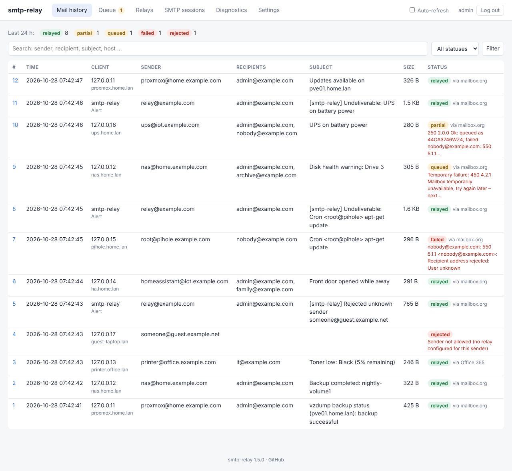
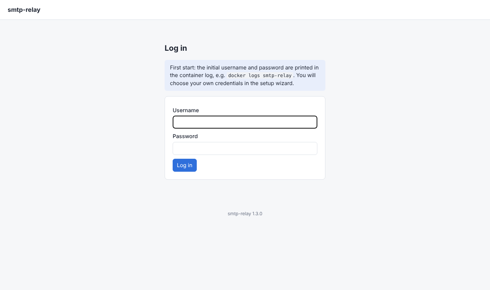
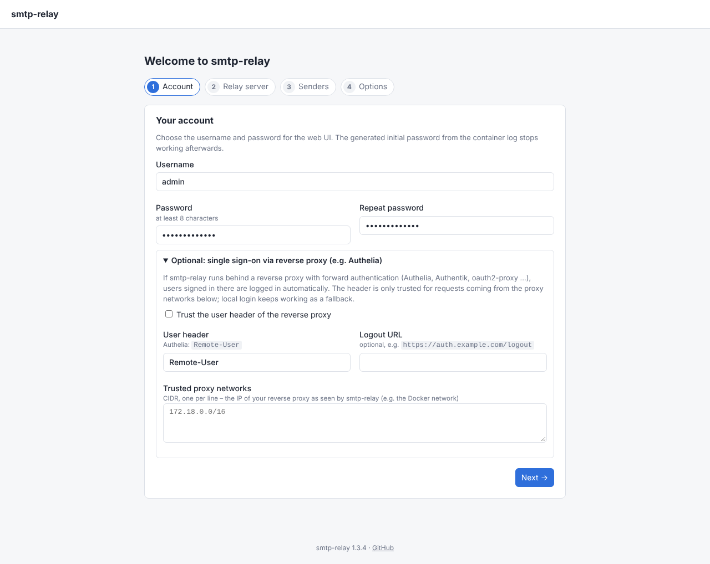
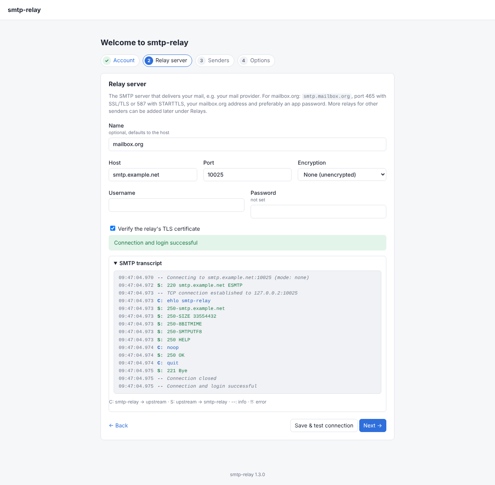
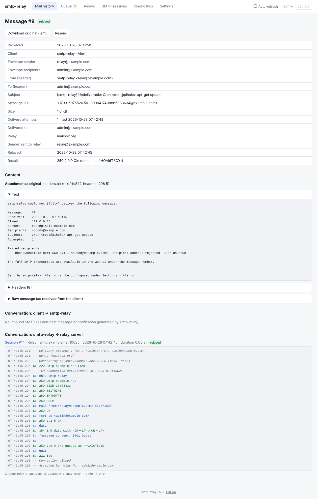
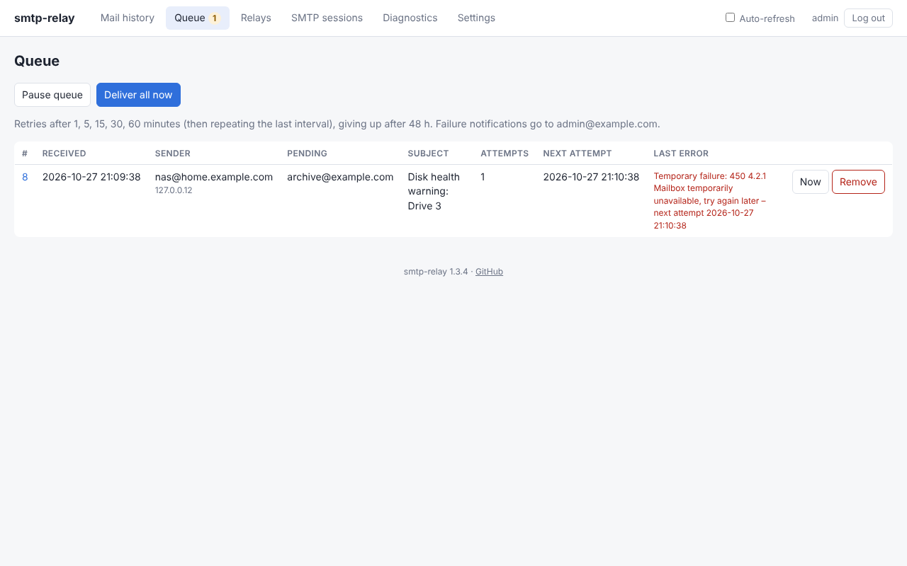
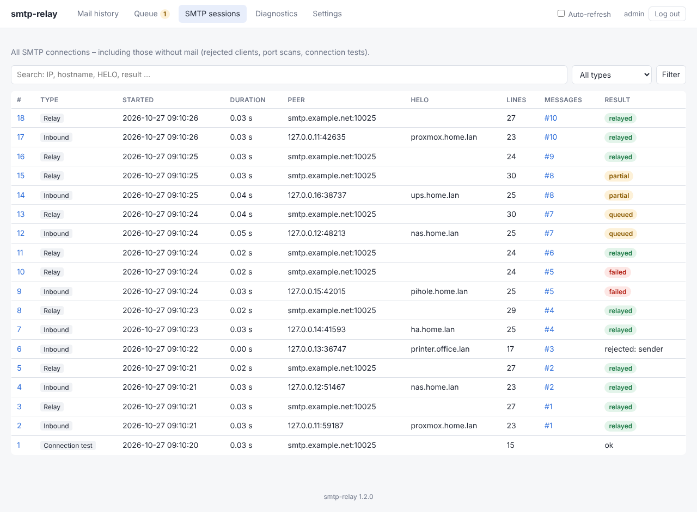
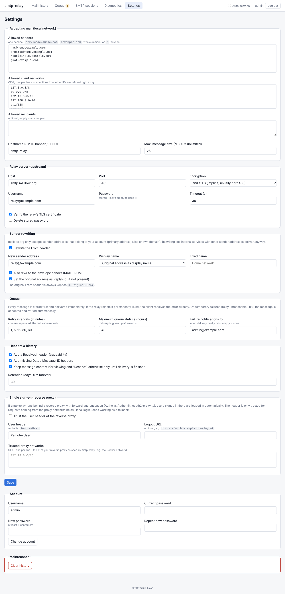
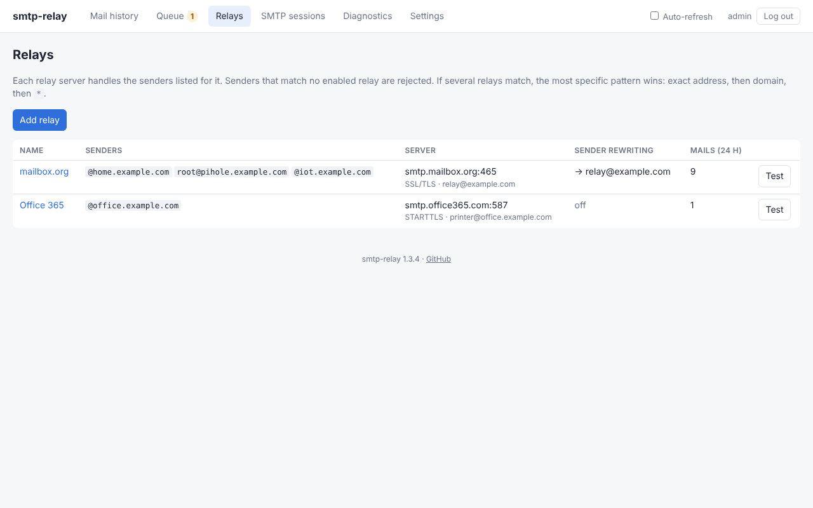
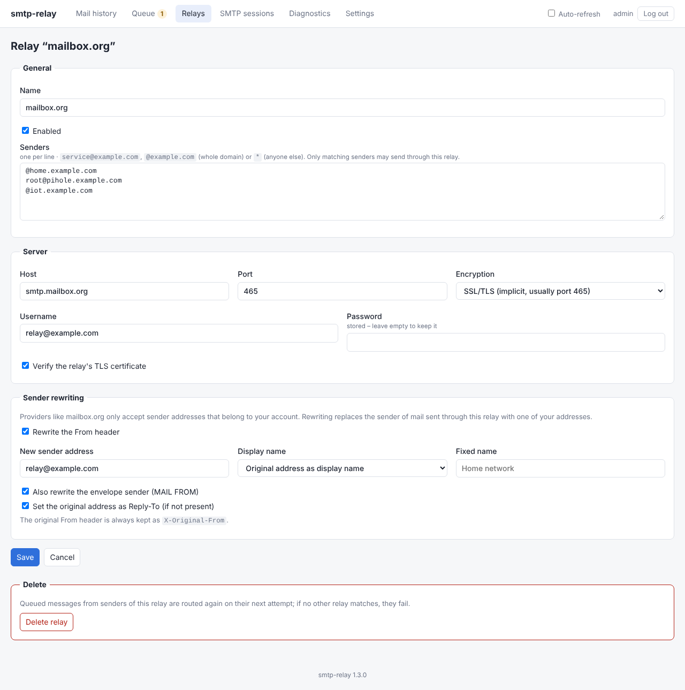

# smtp-relay

A small SMTP relay (smarthost client) in a Docker container. It accepts mail from devices and services on
your local network (NAS, printers, Home Assistant, Proxmox, cron jobs …) and forwards it with
authentication through **mailbox.org** or any other SMTP provider – or through **several providers**, chosen
by sender address or domain. The web UI is built for **maximum diagnostics**: every message and every line of
both SMTP conversations is recorded.



## Features

- **SMTP for the LAN** on container port 2525, mapped to e.g. port 25 on the host
- **Multiple relay servers**, each with its own credentials and sender rewriting
  - Every relay lists the senders it handles: `service@domain.com`, `@domain.com` for a whole domain, or `*`
    for everyone else. The most specific match wins (exact address, then domain, then `*`).
  - Relaying via SSL/TLS (465) or STARTTLS (587) with authentication
- **Access control**
  - allowed client networks (CIDR); other IPs are refused as soon as they connect
  - only senders that match a relay are accepted; everything else is rejected
  - optional allowed recipients
- **Delivery queue with automatic retries** (store-and-forward)
  - Every message is stored in the database first and delivered right away.
  - Permanent rejections from the relay (5xx) are returned to the client directly.
  - On temporary failures (relay unreachable, timeout, 4xx) the message is still accepted with `250` and
    retried later; by default after 1, 5, 15 and 30 minutes, then every 60 minutes.
  - If the relay temporarily rejects only some recipients, only those are retried.
  - Delivery is given up after the maximum queue lifetime (default 48 h).
  - Optionally, a notification goes to an admin address when delivery finally fails.
  - The queue survives container restarts; interrupted deliveries are resumed.
- **Sender rewriting** per relay: the From header (and optionally the envelope sender) is replaced with an
  address that provider accepts.
  - The display name can be kept, or replaced by the original address or a fixed name.
  - Reply-To can be set to the original sender.
  - The original From header is preserved as `X-Original-From`.
- **Setup wizard** on first start: account, first relay server (with connection test), its senders, options.
  No configuration files or environment variables needed.
- **Login** with username and password; the initial password is generated and printed to the container log.
- **Single sign-on** via reverse proxy headers, e.g. **Authelia** (`Remote-User`), restricted to trusted
  proxy networks.
- **Web UI**
  - **Mail history** with time, client IP, reverse DNS and HELO, sender, recipients, subject, size and
    status; search and filters
  - **Message details** with all headers, text and sandboxed HTML preview, attachment list, raw message
    and `.eml` download
  - **Full SMTP conversation client → smtp-relay** with millisecond timestamps
  - **Full SMTP conversation smtp-relay → relay server** for every delivery attempt, including TLS version,
    cipher, certificate and rewrite notes. Credentials are masked.
  - **Queue** with attempts, next attempt and last error; actions “Deliver now”, “Remove”,
    “Deliver all now” and “Pause queue”
  - **All SMTP sessions**, including those without mail: refused IPs, port scans, aborted connections
  - **Resend** for finished messages
  - **Diagnostics**: connection and login test against the relay with full transcript, test message
  - **Settings** that take effect immediately, without a restart
  - Auto-refresh and dark mode
- History in SQLite with configurable retention. Keeping message content permanently can be turned off; it
  is then only kept until delivery is finished.

## Quick start

Prebuilt images for amd64 and arm64 are published to the GitHub Container Registry as
`ghcr.io/commifreak/smtp-relay`.

1. Create a `docker-compose.yml` (or take the one from this repository):

   ```yaml
   services:
     smtp-relay:
       image: ghcr.io/commifreak/smtp-relay:1
       container_name: smtp-relay
       restart: unless-stopped
       environment:
         TZ: Europe/Berlin
       ports:
         - "25:2525"     # SMTP from the local network
         - "8080:8080"   # web UI
       volumes:
         - smtp-relay-data:/data

   volumes:
     smtp-relay-data:
   ```

2. While the image is private, log in to the registry once on the Docker host. Use a GitHub personal
   access token (classic) with the `read:packages` scope:

   ```bash
   echo <TOKEN> | docker login ghcr.io -u <github-user> --password-stdin
   ```

3. Start it and look up the initial password:

   ```bash
   docker compose up -d
   docker logs smtp-relay
   ```

   ```text
   ================================================================
     smtp-relay – initial login
       URL:       http://<docker-host>:8080
       Username:  admin
       Password:  4N38cGvHVJggRfdg
     The setup wizard asks you to choose your own credentials.
   ================================================================
   ```

4. Open `http://<docker-host>:8080`, log in and follow the setup wizard. It asks for your own credentials,
   the first relay server (with a connection test), the senders it handles and the allowed networks, and
   optional sender rewriting and failure notifications. More relays can be added afterwards under **Relays**.

| Login | Setup wizard |
|-------|--------------|
|  |  |



Then send a test message from your network:

```bash
swaks --server <docker-host>:25 --from nas@example.com --to you@example.com --header "Subject: Test"
```

### Forgot the password?

Set `RESET_ADMIN_PASSWORD: "true"` in the `environment` section and restart the container. A new initial
password is printed to the log (the username stays the same). Remove the variable again afterwards, otherwise
the password is reset on every start.

### Updates and image tags

```bash
docker compose pull && docker compose up -d
```

| Tag         | Contents                                                                 |
|-------------|--------------------------------------------------------------------------|
| `1`         | Latest 1.x release – **default in `docker-compose.yml`**, never jumps to 2.x |
| `1.3`       | Latest 1.3.x release (bug fixes only)                                    |
| `1.3.0`     | Exactly this release                                                     |
| `latest`    | Latest build of the `main` branch (may contain unreleased changes)       |
| `sha-…`     | A specific commit                                                        |

Pinning the major version means a future 2.0 with breaking changes will not be installed automatically;
switch to `:2` deliberately after reading the release notes.

### Building from source

Clone the repository, replace the `image:` line in `docker-compose.yml` with `build: .` and run
`docker compose up -d --build`.

## Screenshots

**Message details** with delivery state and both SMTP conversations. Here, one recipient was accepted,
the other was temporarily refused and is queued for a retry:



**Queue**:



**SMTP sessions**:



**Settings**:



### Upgrades and database migrations

Database changes between versions are applied automatically when the container starts. Before that, a backup
of the database is written to `/data/backups/`, and the pending migrations and their results are printed as a
block to the container log:

```text
================================================================
  smtp-relay – database migrations
  Pending migrations: 2
    [2] Add relay columns to messages (1.3)
    [3] Move the single relay configuration into relays (1.3)
  Backup: /data/backups/smtp-relay-20261027-101500-schema-1.db

  [2] Add relay columns to messages (1.3): done – added 2 column(s)
  [3] Move the single relay configuration into relays (1.3): done – created relay “smtp.mailbox.org” from the previous relay settings
  2 migration(s) applied, schema version 3.
================================================================
```

If a migration fails, it is rolled back and the container does not start; the log shows the error. The
backup can be restored by copying it to `/data/smtp-relay.db`. When upgrading from 1.2, the relay server,
allowed senders and sender rewriting are converted into the first relay.

## Multiple relays

Under **Relays** you can add as many relay servers as you like. Each relay has

- a list of **senders** it is responsible for: exact addresses (`nas@home.example.com`), whole domains
  (`@office.example.com`) or `*` as a catch-all,
- its own **server and credentials**,
- its own **sender rewriting** – providers usually only accept their own sender addresses.

For every message the relay with the **most specific matching pattern** is used: an exact address beats a
domain, a domain beats `*`. The same pattern cannot be assigned to two enabled relays. Senders that match no
enabled relay are rejected with `550`, so the sender lists are also the allowlist.

Routing is evaluated on every delivery attempt: if you fix or change a relay while messages are queued, the
next retry uses the new configuration. There is no automatic failover between relays; a failing relay is
handled by the queue and its retries. Test messages under **Diagnostics** can be sent through a specific relay.





## mailbox.org

| Setting         | Value                                   |
|-----------------|-----------------------------------------|
| Host            | `smtp.mailbox.org`                      |
| Port / mode     | `465` / SSL/TLS or `587` / STARTTLS     |
| Username        | your mailbox.org address                |
| Password        | preferably a dedicated app password     |

mailbox.org only accepts sender addresses that belong to your account: primary address, alias or your own
verified domain. For services with arbitrary senders (`root@nas.local` …), enable **Sender rewriting** and
enter one of your own addresses as the new sender address. With “Original address as display name” you can
still see at a glance which service sent the message.

## Single sign-on with Authelia

If the web UI is published through a reverse proxy with forward authentication, smtp-relay can log users in
from the proxy's user header:

1. Configure forward authentication for the smtp-relay host in your proxy and pass on the `Remote-User`
   header. With Traefik, for example, as a middleware:

   ```yaml
   labels:
     - traefik.http.middlewares.authelia.forwardauth.address=http://authelia:9091/api/authz/forward-auth
     - traefik.http.middlewares.authelia.forwardauth.authResponseHeaders=Remote-User,Remote-Groups,Remote-Email,Remote-Name
     - traefik.http.routers.smtp-relay.middlewares=authelia
   ```

2. In smtp-relay under **Settings → Single sign-on** (or in the setup wizard), enable “Trust the user header
   of the reverse proxy”, keep the header `Remote-User` and enter the network your proxy connects from, e.g.
   the Docker network `172.18.0.0/16`. Optionally set Authelia's logout URL.

The header is only accepted from the trusted proxy networks, so clients that reach port 8080 directly cannot
spoof it. Access control (who may use smtp-relay) is configured in Authelia. The local login keeps working as
a fallback, e.g. when the proxy is down.

## Configuration

Everything is configured in the setup wizard and the web UI and stored in the volume
(`/data/smtp-relay.db`). Only these optional environment variables exist:

| Variable           | Default         | Meaning                                                    |
|--------------------|-----------------|------------------------------------------------------------|
| `TZ`               | `Europe/Berlin` | Time zone used for display                                 |
| `RESET_ADMIN_PASSWORD` | –           | `true` prints a new initial password on start              |
| `TLS_CERT_FILE` / `TLS_KEY_FILE` | – | Enables STARTTLS for inbound connections                 |
| `LOG_LEVEL`        | `INFO`          | Log level of the container logs                            |
| `SMTP_LISTEN_PORT` | `2525`          | SMTP port inside the container                             |
| `WEB_PORT`         | `8080`          | Web UI port inside the container                           |

### Client IP and Docker

The network check and the history use the source IP of the connection. In the default bridge mode with port
mapping, the real client IP is usually preserved for IPv4 (iptables DNAT). If the web UI only shows the
gateway IP of the Docker network (e.g. `172.17.0.1`), use one of these options:

- `network_mode: host` in `docker-compose.yml` (then set `SMTP_LISTEN_PORT: 25` and remove `ports:`;
  port 25 then needs root or `cap_add: [NET_BIND_SERVICE]`)
- or `"userland-proxy": false` in `/etc/docker/daemon.json`

## Security notes

- Do **not** expose the SMTP port to the internet. Together with the allowed networks and senders this
  keeps the service from becoming an open relay.
- Complete the setup wizard right after the first start: until then, anyone who can read the container log
  can log in with the initial password.
- The web UI shows message content and holds the relay password, which is stored in the database in the
  volume. Publish it only through HTTPS (reverse proxy) if it is reachable from outside your LAN.
- If message content should not be kept, disable “Keep message content”. While a message is queued, its
  content is still stored. Metadata and SMTP transcripts are kept, but “Resend” is then not available.

## Development

```bash
pip install -r requirements-dev.txt
pytest -q
DATA_DIR=./data python -m app.main
```

Layout:

- `app/smtp_server.py`: SMTP listener (aiosmtpd), policy checks and recording of the inbound conversation
- `app/delivery.py`: queue, delivery attempts, retries and failure notifications
- `app/relay.py`: SMTP connection to the relay (smtplib) with recording of the outbound conversation
- `app/relays.py`: relay servers and sender-based routing
- `app/rewrite.py`: header rewriting on the raw message, so the body stays untouched
- `app/auth.py`: admin account, login sessions and reverse proxy authentication
- `app/web.py` and `app/templates/`: web UI incl. setup wizard (FastAPI and Jinja2, no external browser
  dependencies)
- `app/db.py`: SQLite (settings, sessions, transcript lines, messages)
- `app/migrations.py`: numbered database migrations, reported on container start

The GitHub Action runs the tests on every push and pull request. Pushes to `main` publish the `latest`
image; pushing a version tag publishes the release tags:

```bash
git tag v1.3.0 && git push origin v1.3.0   # -> images 1.3.0, 1.3 and 1
```

Keep `__version__` in `app/__init__.py` in sync with the tag. Database changes for existing installations
are numbered migrations in `app/migrations.py`; see `CLAUDE.md` for the conventions.
